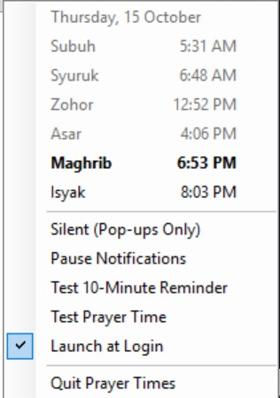

# Prayer Times for Windows

A tiny system tray app for Singapore's daily prayer times. It counts down to the next prayer and notifies you
10 minutes before and at each prayer time. This is the Windows version of [Prayer Times for Mac](https://github.com/stdymuslim-spec/prayer-times-mac).

<p align="center">
  
</p>

- **Tray countdown:** hover over the moon icon to see the next prayer, for example `Asar in 1h 12m`. Click it for
  today's full timetable.
- **Two notifications per prayer** for Subuh, Zohor, Asar, Maghrib and Isyak:
  - **"10 minutes to Asar"**, with a soft chime
  - **"It's time for Asar."**, with the call to prayer
- **Silent mode** for pop-ups without sound, and **Pause** to stop notifications completely.
- **Starts at login** automatically. You can turn that off from the menu.
- **Lightweight:** under 100 KB plus the two sound files, no windows, no network access, and no data collected.

Syuruk (sunrise) is shown in the timetable but doesn't trigger notifications. Clicking a notification stops its sound.

## Requirements

- Windows 10 or 11. Nothing to install: the download is ready to run, and building from source uses the C# compiler
  that comes with Windows.

## Download

Get **`PrayerTimes-Windows.zip`** from the [latest release](https://github.com/stdymuslim-spec/prayer-times-windows/releases/latest),
extract it, and double-click **`PrayerTimes.exe`**. Keep the folder where it is: the app reads the timetable and
sounds from next to the exe. Windows may warn about an unknown publisher because the app isn't code-signed. Choose
**More info**, then **Run anyway**.

## Build from source

1. Download this folder (Code → Download ZIP, then extract it).
2. Double-click **`build.bat`**.

It compiles the app, installs it to `%LOCALAPPDATA%\Prayer Times`, and starts it. Look for the moon icon in the
tray. If it's hidden, drag it out of the `^` overflow area onto the taskbar.

Use **Test 10-Minute Reminder** and **Test Prayer Time** in its menu to check both notifications.

## Updating

Download the new version and run `build.bat` again. It replaces the running copy.

## Next year's timetable

The included timetable covers **1 January 2026 to 31 December 2027**. The menu warns you two weeks before it runs out.
To add a new year:

1. Download the new yearly timetable PDF from the official Singapore prayer timetable source.
2. Install Python 3 and `pdftotext` (part of [Poppler for Windows](https://github.com/oschwartz10612/poppler-windows)).
3. Convert the PDF and rebuild:

   ```
   python tools\parse_timetable.py "Prayer timetable 2028.pdf"
   build.bat
   ```

## Customising

- **Sounds:** the app comes with a short chime (`reminder.mp3`) and a call to prayer (`call_to_prayer.mp3`). To use
  your own, replace those two files in `Resources\` with your own mp3s of the same names, then run `build.bat`.
  Keep each file short. If a file is missing, the app uses a built-in Windows sound instead.
- **Other cities:** replace `Resources\timetable.json` with your own times in the same format, change
  `"Singapore Standard Time"` in `src\PrayerTimes.cs` to your Windows time zone ID, and rebuild.

## Good to know

- **The app must be running.** It checks at the start of every minute, so nothing appears if you quit it.
- **Sleep:** if the PC is asleep at prayer time, that notification is skipped. It isn't played late.
- **Focus Assist / Do Not Disturb:** Windows may hide the pop-up while it's on, but the sound still plays. Use
  **Silent** when you need quiet.
- **Double sound:** Windows may play its own notification ping alongside the chime. You can turn that off in
  Settings → System → Notifications → Prayer Times.

## Uninstall

1. Untick **Launch at Login** in the app's menu.
2. Choose **Quit Prayer Times**.
3. Delete `%LOCALAPPDATA%\Prayer Times`.

## Project layout

| Path | What it is |
|---|---|
| `src\PrayerTimes.cs` | The whole app |
| `docs\screenshot.png` | The screenshot in this README |
| `Resources\timetable.json` | Prayer times by date (Singapore time) |
| `Resources\*.mp3` | The two notification sounds (replaceable) |
| `tools\parse_timetable.py` | Converts a yearly timetable PDF to JSON |
| `build.ps1` / `build.bat` | Builds, installs and launches the app |

## Credits

- **Reminder sound:** "Notification 11" by soundreality on [Pixabay](https://pixabay.com/).
- **Call to prayer:** from [Zedge](https://www.zedge.net/).

The sound files belong to their creators and aren't covered by this project's license.

## License

The code is released under the [MIT License](LICENSE).
